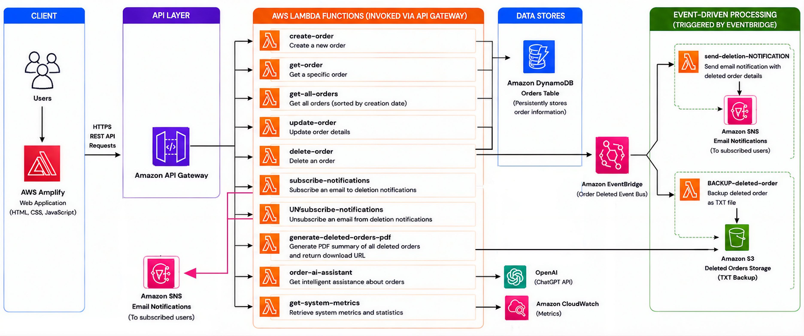

# Event-Driven Serverless Order Management System

A web-based order management system built with AWS serverless services. The project combines REST APIs, event-driven workflows, automated notifications and backups, and an AI-powered order assistant.

## Tech Stack

- **Frontend:** HTML, CSS, JavaScript
- **Backend:** Python, AWS Lambda, Amazon API Gateway
- **Data & events:** Amazon DynamoDB, Amazon EventBridge
- **Storage & notifications:** Amazon S3, Amazon SNS
- **Monitoring & hosting:** Amazon CloudWatch, AWS Amplify
- **AI integration:** OpenAI API

## Key Features

- Create, view, update, and delete orders through a web interface.
- Process order-deletion events asynchronously with Amazon EventBridge.
- Back up deleted-order information to Amazon S3.
- Send automated email notifications through Amazon SNS.
- Generate downloadable order reports.
- View system-monitoring information and use an AI-powered order assistant.

## Architecture

The frontend communicates with REST API endpoints exposed through Amazon API Gateway and implemented by AWS Lambda functions. Amazon DynamoDB stores order records, while other AWS services handle events, backups, notifications, and monitoring.



For more details about the system design, API flows, implementation, and testing, see the [technical documentation](docs/Technical_Documentation.pdf).

## Repository Structure

```text
AWS Event-Driven Serverless Order Management System/
├── docs/
│   ├── Architecture.png
│   ├── Project_Summary.pdf
│   ├── Project_Summary_HE.pdf
│   └── Technical_Documentation.pdf
├── Order_Management_System_Frontend/   # Available frontend source code
└── README.md
```

The frontend folder name shown above follows the previous README. Check that it matches the folder name in the repository.

## Project Documentation

- [Project Summary (English)](docs/Project_Summary.pdf)
- [Project Summary (Hebrew)](docs/Project_Summary_HE.pdf)
- [Technical Documentation](docs/Technical_Documentation.pdf)
- [System Architecture Diagram](docs/Architecture.png)

## Project Status

This project was developed and tested in a temporary **AWS Learner Lab** environment. The lab account has since expired, and the original cloud backend is no longer deployed. As a result, the complete application is **not currently runnable**.


